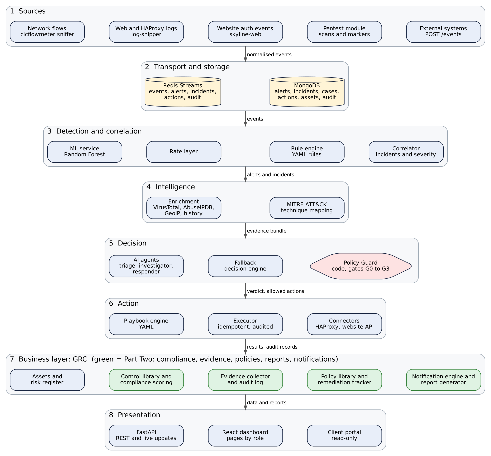
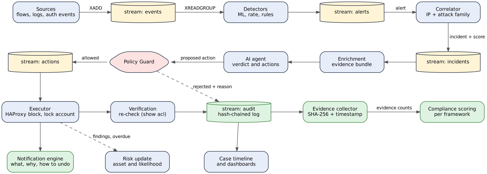
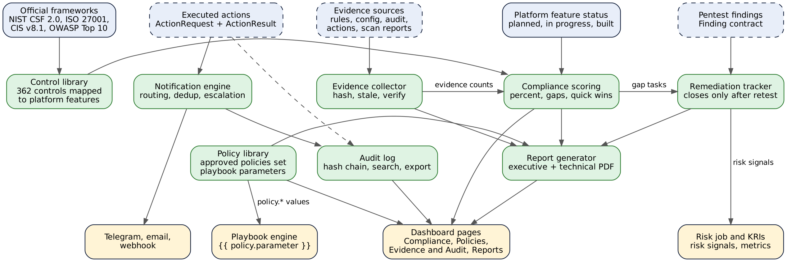
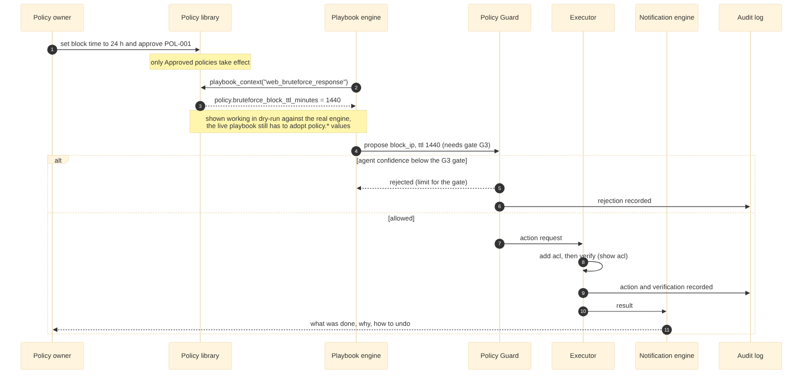

# Sentinel architecture and data flow

Source of truth: the Project Details document (sections 2 and 3) and the Task Plan (section 10, shared contracts).
Diagrams are generated from the files in `diagrams/` (see `diagrams/render.sh`). Edit the source, then re-render.

## 1. System architecture

Eight layers, top to bottom: sources, transport and storage (Redis Streams, MongoDB), detection and correlation,
intelligence, decision (AI agents, fallback engine, Policy Guard), action (playbook engine, executor, connectors),
the business layer (GRC) and presentation. Green boxes are GRC Part Two (compliance, evidence, policies, reports,
notifications). This is the target design; see the status table in `README.md` for what is built.

## 2. End-to-end data flow

An event travels through the `events`, `alerts`, `incidents` and `actions` streams. The Policy Guard (code) sits
between the agent and the executor and its rejections are audited. After the executor, three things happen in
parallel: verification and the hash-chained audit log, the notification message, and the risk update.

## 3. GRC Part Two components

Dashed borders are inputs that still come from sample data (`data/mock`, `sample_sources`).

## 4. From policy to action

An approved policy supplies `policy.*` parameters to a playbook. The Policy Guard still limits the result by gate
(24 hours needs G3). Demonstrated in dry-run with `policy_demo.py`; the live playbook still has to adopt the parameter.
